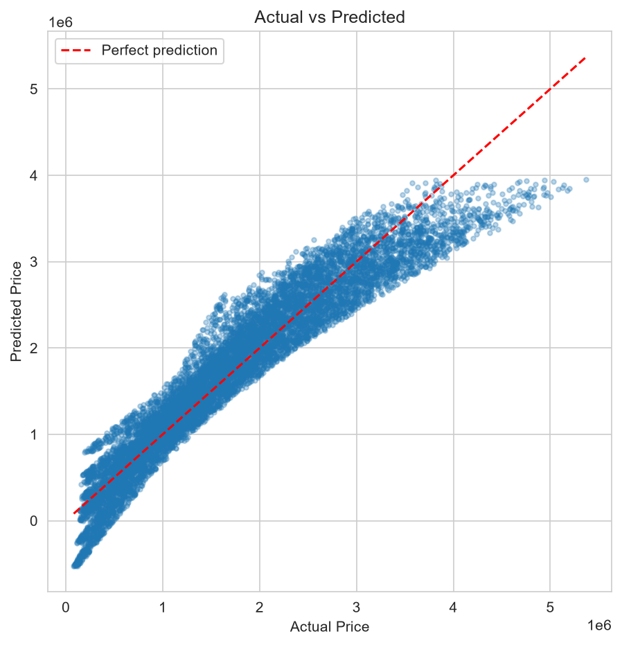
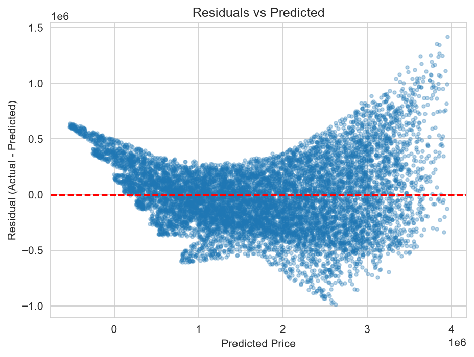
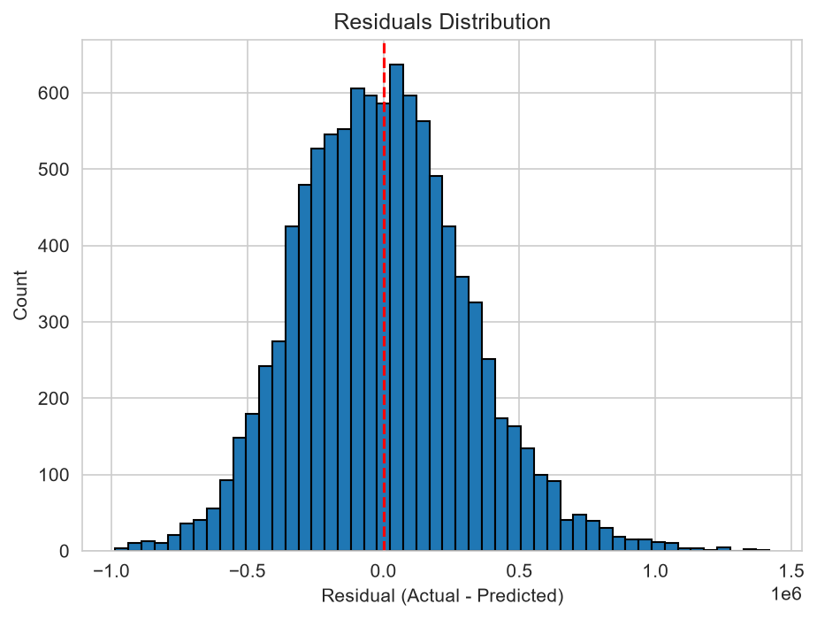
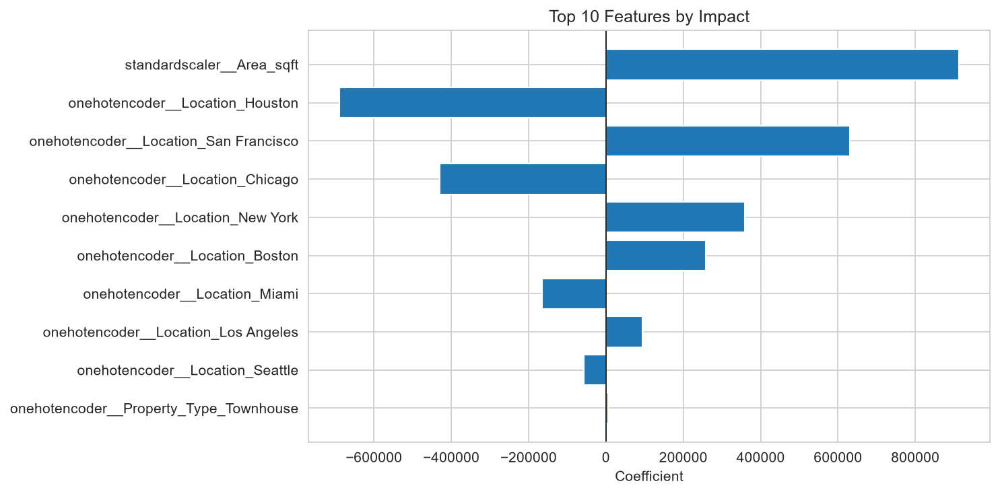

# House Price Prediction with Linear Regression

Predicting house prices in the US from property features using a Linear Regression model, with a full evaluation of the model's performance and assumptions.

## Dataset

- **Size:** 50,000 houses, 8 features plus the target (`Price_USD`)
- **Source:** [House Prices dataset on Kaggle](https://www.kaggle.com/datasets/prince7489/house-prices)
- **File:** `data/house_prices.csv`

| Feature | Type | Description |
|---------|------|-------------|
| Location | Categorical | City (Boston, Chicago, Houston, Los Angeles, Miami, New York, San Francisco, Seattle) |
| Area_sqft | Numeric | Living area in square feet |
| Bedrooms | Numeric | Number of bedrooms |
| Bathrooms | Numeric | Number of bathrooms |
| Garage | Numeric | Number of garage spaces |
| Year_Built | Numeric | Year of construction |
| Property_Type | Categorical | Apartment, Bungalow, Townhouse, Villa |
| Distance_to_CityCenter_km | Numeric | Distance to the city center in km |
| **Price_USD** | **Target** | House price in US dollars |

`House_ID` was dropped because it is only an identifier.

## Workflow

1. **Split:** 80% training (40,000 rows) and 20% testing (10,000 rows), `random_state=42`.
2. **Preprocessing** with `ColumnTransformer`:
   - `StandardScaler` for the numeric features
   - `OneHotEncoder(handle_unknown="ignore")` for `Location` and `Property_Type`
   - The transformer is fitted on the training set only, to avoid data leakage.
3. **Training:** `LinearRegression` on the 18 transformed features.
4. **Evaluation:** MAE, RMSE and R² on both training and test sets, compared against a baseline that always predicts the mean price.
5. **Diagnostics:** Actual vs Predicted, residual plots, and coefficient analysis.

## Results

| Model / Set | MAE | RMSE | R² |
|-------------|-----|------|----|
| Linear Regression (Train) | 247,262 | 313,909 | 0.9101 |
| Linear Regression (Test) | 246,759 | 311,930 | 0.9086 |
| Baseline: mean price (Test) | 855,510 | 1,032,003 | 0.0000 |

- The model explains about **91%** of the variance in house prices.
- The average error on the test set is about **$247K**, roughly **14%** of the mean price ($1.74M).
- Train and test scores are almost identical, so there is no sign of overfitting.
- Compared with the baseline, MAE dropped by about 71%.

## Plots

### Actual vs Predicted


### Residuals vs Predicted


### Residuals Distribution


### Top 10 Features by Impact


## Key Findings

- **Area and location drive the price.** `Area_sqft` has by far the largest coefficient (about +913K per one standard deviation). City comes second: San Francisco is the most expensive and Houston the cheapest, a gap of about $1.32M for otherwise identical houses.
- **Other features have a very small effect** in the linear model (bedrooms, bathrooms, garage, year built, distance to the city center, property type).
- **Residual analysis shows mild non-linearity.** The residuals vs predicted plot has a U-shape and a funnel shape: the model underestimates expensive houses, the error grows with price, and some predictions for cheap houses are negative.
- **Log-transforming the target did not help.** Training on `log(price)` and converting back gave worse results (MAE 309,855, RMSE 435,781, R² 0.8217), so the relationship is not simply multiplicative.

## Limitations and Next Steps

- A linear model cannot capture the curvature visible in the residuals. Tree-based models such as Random Forest or Gradient Boosting are a natural next step.
- Coefficients of one-hot encoded columns are relative to each other, not absolute values.
- Cross-validation can be added for a more robust estimate of performance.

## Run It

```bash
pip install -r ../requirements.txt
jupyter notebook notebook.ipynb
```
